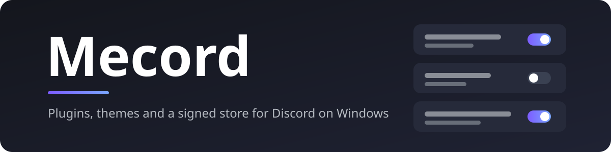
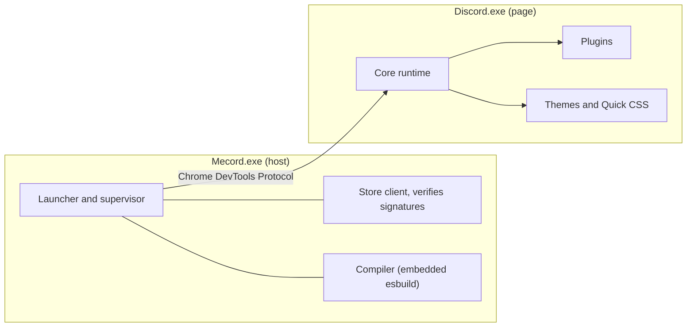

<p align="center">
  
</p>

<p align="center">
  <a href="https://github.com/menscho/Mecord/releases/latest"></a>
  
  
  
</p>

<p align="center"><b>Plugins, themes and a signed plugin store for the Discord desktop app on Windows.</b></p>

<p align="center">
  <a href="#install">Install</a> ·
  <a href="#uninstall">Uninstall</a> ·
  <a href="#build-from-source">Build</a> ·
  <a href="#features">Features</a> ·
  <a href="#plugins">Plugins</a> ·
  <a href="#write-a-plugin">Write a plugin</a> ·
  <a href="#how-it-works">How it works</a> ·
  <a href="#security-model">Security</a> ·
  <a href="#status-and-known-limitations">Status</a>
</p>

> [!WARNING]
> **Mecord breaks Discord's Terms of Service.** Discord does not allow modifications to its client. Accounts that use client mods can be warned, suspended or banned, and a Discord update can break Mecord at any time without notice. Use it at your own risk, ideally on an account you can afford to lose. Read [the warnings below](#read-this-first) before you install anything.

---

## What is Mecord?

Mecord is a small Windows program, `Mecord.exe`, that works with your installed Discord. It starts Discord with a local debug endpoint, attaches to it, and injects a runtime into the page before Discord's own scripts run. That runtime manages plugins, themes, Quick CSS and a wallpaper, and opens a settings window from a button in Discord's title bar.

Mecord never patches Discord's files on disk. Start Discord without Mecord, or with `Mecord.exe --vanilla`, and you get the stock client.

## Read this first

- **It is against Discord's Terms of Service.** Discord does not allow modifying its client. Discord can warn, suspend or permanently ban accounts that use Mecord. This is a real risk, not a hypothetical one.
- **It can break at any time.** Mecord relies on Discord's internal code and CSS class names, which Discord changes often. An update can break plugins or Mecord itself, and nobody is obliged to fix it quickly.
- **Plugins are code.** Plugins run inside Discord's page with the same access Discord has, which includes your messages and, in principle, your login token. Mecord itself does not read or store your token, but a plugin could. Install only plugins you trust. Your own plugins are fully trusted by definition.
- **No warranty.** Mecord is provided as is. See [License](#license).
- **Not affiliated with Discord.** Mecord is an independent community project. "Discord" is a trademark of Discord Inc.

## Features

| Area | What you get |
| --- | --- |
| **Plugins** | Turn plugins on and off, change their settings and update them from a window in Discord. Plugins can add slash commands, context-menu items, toasts, settings pages, CSS and patches to Discord's code. Plugins you write hot-reload on save. |
| **Plugin store** | Browse and install the 69 built-in plugins without restarting. Every file is checked against an Ed25519-signed index and SHA-256 hashes before it is used. Installs are staged and swapped in atomically, with crash recovery. |
| **Themes** | Nine built-in themes with live previews. Load BetterDiscord-style CSS theme files from a folder or a URL. **Quick CSS** is always applied last, so your own rules win. |
| **Look** | A wallpaper (image or video) behind the chat, which pauses when Discord is not focused. Sliders for opacity, blur and dimming. |
| **Health and recovery** | Shows the state of every Discord patch, plugin errors, startup timing, long frames, GPU status and the log. If Discord fails to start cleanly three times in a row, Mecord switches to safe mode. |
| **Backups** | One JSON file with settings, plugin state, themes and Quick CSS. Import in merge or replace mode; a snapshot is taken first. Secret-looking settings are never exported. |
| **Patch editor** | Search Discord's module source live, test a regex replacement with a before/after preview, and save the result as a plugin. |
| **Performance Suite** | Optional lighter effects, a faster member list, smoother typing and an opt-in GPU boost that is applied when Discord starts. |

## Install

### Release build (recommended)

Requirements: Windows 10 or 11, and the Discord desktop app installed (stable channel).

1. Download `Mecord-0.1.0-windows-x64.zip` from the [latest release](https://github.com/menscho/Mecord/releases/latest) and extract it. Keep the `store` folder next to `mecord.exe`; that is where the plugin catalog lives.
2. Run `mecord.exe --install-shortcut` once. It creates a Mecord shortcut on your desktop that uses Discord's icon. Start Discord through that shortcut from now on.
3. If Discord is already running without Mecord, Mecord asks before it restarts Discord. A restart is the only way to attach.
4. Click the gray **M** in Discord's title bar, or press **Ctrl+Shift+M**.

The zip also contains `uninstall.exe`, which removes Mecord again. See [Uninstall](#uninstall).

The executable is not code-signed, so Windows SmartScreen may warn on first run. Check the file against the SHA-256 hashes in the release notes before you run it.

### Build from source

Requirements:

- Windows 10 or 11
- [Rust](https://rustup.rs) (stable, MSVC toolchain, with the Visual Studio C++ build tools for linking)
- [Node.js](https://nodejs.org) 20 or newer

```bash
git clone https://github.com/menscho/Mecord.git
cd Mecord
npm install
npm run build
```

`npm run build` typechecks the TypeScript, bundles the Discord runtime, builds the signed plugin catalog and compiles `target\release\mecord.exe` and `target\release\uninstall.exe`. Run `mecord.exe` from the repository. It finds the `store` folder in the repository root by itself.

> **About signing keys.** The first `npm run build` creates `keys/store.key`, a private signing key that stays on your machine and is git-ignored. Mecord only trusts catalogs signed by the public key in `keys/store.pub`, which is compiled into the exe. A source build therefore signs its own catalog. Keep `store.key` safe. If it is lost, a new key is created and the exe has to be rebuilt.

## Using Mecord

### Command-line flags

| Flag | Effect |
| --- | --- |
| `--vanilla` | Start Discord with none of Mecord involved |
| `--safe-mode` | Inject only the diagnostics UI: no plugins, themes, Quick CSS or wallpaper |
| `--disable-plugin=<id>` | Turn a plugin off (persistently) before launch |
| `--diagnose` | Open the Health tab once Discord is ready |
| `--install-shortcut` | Create a desktop shortcut that uses Discord's icon |
| `--reset` | Move the settings file aside (it is kept in `backups/`) |
| `--ptb` / `--canary` | Target Discord PTB or Canary (implemented, not yet tested) |

### Where things live

| What | Where |
| --- | --- |
| Settings | `%AppData%\Mecord\config.json` |
| Plugins you wrote | `%AppData%\Mecord\userplugins\` |
| Theme CSS files | `%AppData%\Mecord\themes\` |
| Backups | `%AppData%\Mecord\backups\` |
| Log | `%AppData%\Mecord\logs\mecord.log` |
| Desktop shortcut | `Mecord.lnk` on your desktop (created by `--install-shortcut`) |

Mecord runs in the background while Discord is open and exits when Discord does. It has no tray icon.

### Automatic recovery

If the injected runtime does not report ready within 25 seconds, the host removes the injection and reloads a clean page, so Discord keeps working. Three failed starts in a row switch Mecord to safe mode until you press **Leave safe mode** in the Health tab.

## Uninstall

The release zip includes `uninstall.exe`. Double-click it in the Mecord folder. It asks once, then removes Mecord completely:

- Mecord's data folder, `%AppData%\Mecord`: settings, installed plugins, your own plugins, themes, logs and internal backups
- the **Mecord** shortcut on your desktop
- `mecord.exe`, `QUICKSTART.txt`, `uninstall.exe` and the `store` folder in the Mecord folder, and the folder itself if nothing else is left in it

It stops Mecord first, including the helper programs it started. It keeps:

- backups you exported to your Documents folder (`Mecord-backup-*.json`). Delete them yourself if you no longer need them
- Discord. Its files are never changed. Restart Discord afterwards; the running Discord keeps Mecord until it restarts

### Command line

The same removal as a single paste, for when you would rather not run an exe. Paste it into **Command Prompt** (cmd, not PowerShell) and change the first line to your Mecord folder:

```bat
set "MECORD_DIR=%USERPROFILE%\Downloads\Mecord-0.1.0-windows-x64"
taskkill /F /IM mecord.exe >nul 2>&1
powershell -NoProfile -Command "Get-CimInstance Win32_Process | Where-Object { $_.CommandLine -and $_.CommandLine.Contains((Join-Path $env:APPDATA 'Mecord\cache\native')) } | ForEach-Object { Stop-Process -Id $_.ProcessId -Force }"
ping -n 3 127.0.0.1 >nul
rmdir /S /Q "%APPDATA%\Mecord"
powershell -NoProfile -Command "Remove-Item -LiteralPath (Join-Path ([Environment]::GetFolderPath('Desktop')) 'Mecord.lnk') -Force -ErrorAction SilentlyContinue"
del /F /Q "%MECORD_DIR%\mecord.exe" "%MECORD_DIR%\QUICKSTART.txt" "%MECORD_DIR%\uninstall.exe" 2>nul
rmdir /S /Q "%MECORD_DIR%\store" 2>nul
rmdir "%MECORD_DIR%" 2>nul
```

It keeps the same things as `uninstall.exe`. Restart Discord afterwards.

## Plugins

The catalog has 69 plugins in eight categories. The built-in plugins live in [`plugins/`](plugins/), one folder each, and can be installed from the **Browse** tab. Entries marked *network* list the hosts they call. Entries marked *native helper* ask for your consent before they run anything.

<details open>
<summary><b>Chat</b> &nbsp;·&nbsp; 14 plugins</summary>

| Plugin | What it does |
| --- | --- |
| **Bridge Cleaner** | Tidies messages relayed by bridges, webhooks and bots. "[TG] Alice" shows as Alice with a small TG badge, and the BOT tag, role icons and repeated names on those messages can be hidden. Every part is optional in settings. |
| **Copy Code Blocks** | Adds a Copy button to every code block in chat. |
| **Double Click Reply** | Double-click a message to reply to it. |
| **Emoji Tools** | Right-click a custom emoji to copy its image URL or ID. |
| **Full Timestamps** | Always shows the complete date and time on messages, instead of "Today at …". |
| **Inline Translate** | Translate any message right under it (right-click → Translate Inline), or translate text you type with /translate. *network: translate.googleapis.com* |
| **Mention Highlight** | Colors your own mentions and mention-messages distinctively. |
| **Message Bookmarks** | Right-click a message → Bookmark. Review, open or delete bookmarks from this plugin's settings. Stored on your PC only. |
| **No Embeds** | Hides link previews and embeds under messages. |
| **No Stickers** | Hides stickers in chat. |
| **Quote Selection** | Select text in a message, right-click → Quote Selection to paste it as a blockquote into the chat box. |
| **Reveal Spoilers** | Spoiler text and spoiler images are shown automatically instead of needing a click. |
| **Translator** | Translate what you write before it's sent, and read other people's messages in your language. One button in the chat bar; works per channel. *network: translate.googleapis.com, api-free.deepl.com, api.deepl.com* |
| **Who Reacted** | Hover a reaction to see who added it (first 20 people), without opening a menu. |

</details>

<details>
<summary><b>Typing</b> &nbsp;·&nbsp; 6 plugins</summary>

| Plugin | What it does |
| --- | --- |
| **Auto Replace** | Replaces words or phrases in messages as you send them (e.g. "brb" → "be right back"). Rules are edited in the plugin's settings. |
| **No Spellcheck** | Turns off the red spellcheck underlines in the chat box. |
| **Scroll To Bottom Key** | Press Ctrl+End to jump to the newest message in the current channel. |
| **Text Formatters** | /clap, /mock, /reverse, /wide, /spoiler, /bubble: transform text before sending. |
| **Text Snippets** | Save reusable messages in the plugin's settings (one "name = text" per line) and send them with /snip name. |
| **Word Counter** | Shows characters and words of the message you're typing, turning red past Discord's 2000-character limit. |

</details>

<details>
<summary><b>Look & feel</b> &nbsp;·&nbsp; 10 plugins</summary>

| Plugin | What it does |
| --- | --- |
| **Accent Color** | Override Discord's brand/accent color. |
| **Chat Font Size** | Set the message text size independently of Discord's setting. |
| **Code Font** | Choose the font used in code blocks and inline code. |
| **Custom Font** | Use any installed font for the whole interface. |
| **Custom Scrollbars** | Slim, theme-friendly scrollbars everywhere. |
| **Disable Animations** | Turns off interface animations and transitions. |
| **Emoji Size** | Make emoji bigger in chat. |
| **Flat Design** | Removes shadows and rounded corners for a flatter look. |
| **Rounded UI** | Adjust the corner radius of panels and messages. |
| **Square Avatars** | Squares off round avatars (slightly rounded corners). |

</details>

<details>
<summary><b>Layout</b> &nbsp;·&nbsp; 10 plugins</summary>

| Plugin | What it does |
| --- | --- |
| **Compact Plus** | Tighter spacing in messages, member list and channel list. |
| **Hide Active Now** | Hides the Active Now column on the Friends page. |
| **Hide Gift Button** | Removes the gift button from the chat bar. |
| **Hide Profile Banners** | Hides profile banners and profile effects in popouts and cards. |
| **Hide Reactions** | Hides reactions under messages. |
| **Hide Server Banners** | Hides the banner image at the top of server channel lists. |
| **Members Toggle** | Press Ctrl+Alt+M to hide or show the member list for more chat space. |
| **No Nitro Upsells** | Hides Nitro/Shop/Quests promotions and upsell banners. |
| **Wide Chat** | Lets messages use the full width, or limits them to a readable column. |
| **Zen Mode** | Press Ctrl+Alt+Z to hide the server list, channel list and member list: just the conversation. |

</details>

<details>
<summary><b>Media</b> &nbsp;·&nbsp; 3 plugins</summary>

| Plugin | What it does |
| --- | --- |
| **Image Zoom** | Hold Alt while hovering an image in chat to magnify it under the cursor. |
| **Music Player** | Now-playing widget with play/pause/skip for whatever Windows is playing (Spotify, browsers, media players), plus /nowplaying. Uses a native helper (PowerShell) and asks for your consent first. *native helper, asks for consent* |
| **Voice Messages** | Adds a microphone button to the chat bar: record, then the clip is attached to your message as an audio file (not Discord's native voice-message type). |

</details>

<details>
<summary><b>Privacy</b> &nbsp;·&nbsp; 7 plugins</summary>

| Plugin | What it does |
| --- | --- |
| **Blur Images** | Blurs images and videos in chat until you hover them (handy at work or on stream). |
| **Clear URLs** | Strips tracking parameters (utm_*, fbclid, gclid, …) from links you send and from links shown in chat. |
| **Hide Typing Indicator** | Hides the "someone is typing…" bar under the chat box. |
| **Message Logger** | Keeps deleted messages visible (marked in red) and records the edit history of edited messages, for this session. |
| **No Track** | Blocks Discord's analytics ("science"), metrics and Sentry error-report requests before they leave the app. |
| **Privacy Blur** | Press Ctrl+Alt+B to blur usernames, avatars, server and DM names (screen sharing, screenshots). Press again to reveal. |
| **Silent Typing** | Hides your "is typing…" indicator from everyone. Toggle at any time with /silent-typing. |

</details>

<details>
<summary><b>Tools</b> &nbsp;·&nbsp; 13 plugins</summary>

| Plugin | What it does |
| --- | --- |
| **Base64 Tools** | /b64 encode\|decode <text>: Unicode-safe Base64. |
| **Calculator** | /calc 2*(3+4)^2 — a safe expression evaluator (no eval). Supports + - * / % ^, parentheses, pi, e, sqrt/sin/cos/tan/log/ln/abs/round/floor/ceil. |
| **Channel Notes** | Private per-channel notes (stored on your PC only). Press Ctrl+Alt+N to open the notepad for the current channel. |
| **Dice Roller** | /roll 2d6+3 (any NdM±K) and /flip for a coin toss. |
| **Fun Commands** | /lenny, /disapproval, /sparkles, /8ball and /owo; optional text is appended. |
| **Message Reminders** | Right-click a message → Remind me to come back to it. When it's due you get a Mecord notification with a Jump button. Reminders are stored on your PC only. |
| **Password Generator** | /password [length] generates a strong random password and copies it to your clipboard. It is never sent to chat. |
| **Quick Actions** | Right-click helpers: copy message link/text/ID, copy image URL, reverse-image search, translate. *network: translate.googleapis.com* |
| **Quick Status** | /status online\|idle\|dnd\|invisible changes your presence without opening menus. |
| **Send Later** | /later in 2h your message sends it in this channel later. Also "tomorrow 09:30", "18:00" or "2026-12-24 18:00". Cancel or resend pending messages in the plugin's settings. Messages only go out while Mecord is open. |
| **Send Timestamp** | /timestamp 2026-12-24 18:00 sends a Discord timestamp that shows in every reader's own timezone. Also accepts "in 2h", "in 3d", "tomorrow 09:30". |
| **Session Clock** | Shows the time and how long Discord has been open this session, in a small corner badge. |
| **Timezones** | Remember a timezone per person (right-click a user → Set Timezone) and see their local time next to every message timestamp. |

</details>

<details>
<summary><b>Developer</b> &nbsp;·&nbsp; 6 plugins</summary>

| Plugin | What it does |
| --- | --- |
| **Copy IDs** | Right-click users, channels and servers to copy their IDs (no Developer Mode needed), and see when an ID was created. |
| **Experiments** | Unlocks Discord's developer/experiment toggles (DeveloperExperimentStore). Best effort: depends on Discord's internals and can break on any update. |
| **FPS & Memory Overlay** | A tiny overlay with the UI's frame rate, average frame time, 1% low and JS memory use. Handy for judging the Performance Suite. |
| **Performance Suite** | Lighter effects, a faster member list, smoother typing and optional GPU and renderer flags. |
| **Show Message IDs** | Shows each message's ID next to its timestamp (click to copy). Useful for bots and debugging. |
| **UUID Generator** | /uuid sends a random UUID v4; /snowflake <id> shows when a Discord ID was created. |

</details>

## Themes

Nine built-in themes: **Midnight Ink**, **Espresso**, **Glacier**, **Rosé Dusk**, **Evergreen**, **Obsidian**, **Paper**, **Ember** and **Lagoon**. Pick one from the gallery in the **Themes** tab, where each one has a live preview.

You can also add your own CSS theme files, either from the `themes` folder or from a URL. Theme files can use BetterDiscord-style `@name` and `@author` headers. Both kinds update live when you save them.

**Quick CSS** is a text box for your own rules. It is always injected last, so it wins over themes and plugins. The **Style** tab also holds the wallpaper settings.

## Write a plugin

A plugin is a single file (or a folder with an `index.ts`). Here is a complete example:

```ts
// @name Hello
// @version 1.0.0
// @description Says hello
import { definePlugin, Commands, Toasts } from "@mecord/api";

export default definePlugin({
  name: "Hello",
  settings: { shout: { type: "boolean", default: false, label: "Shout" } },
  start(ctx) {
    ctx.add(Commands.register({
      name: "hello", description: "Say hello",
      execute: () => ({ content: ctx.settings.get("shout") ? "HELLO!" : "hello" }),
    }));
    Toasts.show("Hello started");
  },
});
```

Save it as `%AppData%\Mecord\userplugins\hello.ts`. It appears in the **Plugins** tab and reloads each time you save it.

The full API is typed in [`plugins/api.d.ts`](plugins/api.d.ts). Patches target Discord's code by matching a unique string, and use `\i` for "any identifier" and `$self` to call into your plugin:

```ts
patches: [{ find: "some unique string", replacement: { match: /(\i)\.foo\(/, replace: "$self.hook($1)||$1.foo(" } }]
```

Exceptions thrown from `$self` are caught, logged and returned as `undefined`, so a plugin bug cannot take down Discord's interface. If a patch targets code that has already run, it shows as **needs-reload**; **Reload Discord UI** applies it.

## How it works



1. Mecord finds your newest Discord install and either attaches to a running instance or starts Discord with a debug endpoint on a loopback port.
2. It injects the core runtime before Discord's own scripts run.
3. The core hooks Discord's module loader, starts the enabled plugins and reports back to the host.
4. Changes made in the window (installing a plugin, editing a theme, changing settings) go through the host, which writes them safely.

The full design, with the process model and trade-offs, is in [`docs/DESIGN.md`](docs/DESIGN.md).

## Security model

- **Trust chain for the store.** A pinned Ed25519 key signs the catalog index, which carries a monotonic version and an expiry. Rollbacks and expired indexes are refused. Each file is checked against its SHA-256 hash, paths are validated against traversal, and sizes are capped. Tampered files and tampered indexes have been tested and are refused.
- **Native helpers** run as separate processes from a private, hash-verified copy. Consent is bound to the helper's SHA-256 and is requested through a **native Windows dialog from the host**, so Discord's page cannot click it. An update that changes the helper asks again. Helpers are not sandboxed beyond running as your user.
- **Network capabilities** (`net:<host>`) are enforced for the network API that Mecord proxies. They are **not** a sandbox: plugin JavaScript runs in Discord's page and can do anything the page can. Code review and signing are the real protection.
- **Debug endpoint.** Listens on loopback with a random port and allows no cross-origin access. Any local process running as you could connect to it while Discord is open. It closes when Discord restarts normally. The page's Content Security Policy is bypassed, which is needed to compile plugins at runtime.
- **Local data.** Config, plugins and backups live in `%AppData%\Mecord`. The wallpaper server only serves files you configured, behind a random token.

## Status and known limitations

**Verified against Discord 1.0.9261 on Windows 11:** injection and recovery, webpack patching, every built-in plugin loading and starting, store install, update and removal (including tamper tests), hot reload of TSX user plugins, themes (local, URL and live update), Quick CSS ordering, wallpaper serving, backup merge and replace, native plugin consent, safe mode, crash isolation, and network capability enforcement. The GPU status call of the Health tab was checked against a live Discord, and the GPU boost flags were confirmed active.

**Not yet verified in a live session:**

- the Performance and Graphics panels of the Health tab, and the **Restart Discord** button
- the Skia Graphite option (off by default)
- Message Logger on real deletions and edits, the voice recorder, Timezones' per-user display, Who Reacted's list, Image Zoom and most CSS-only plugins. Their selectors depend on Discord's hashed class names, which can drift with updates. Diagnostics does not flag a CSS plugin whose selectors stop matching.
- PTB and Canary

**Other gaps:** no tray icon, no installer (there is an uninstaller) and no custom exe icon. The Patch Editor and Quick CSS are plain text areas without syntax highlighting. Discord's own self-update restart is detected, but you need to click to re-attach. Only one Discord channel is supervised at a time. The catalog is not yet hosted anywhere; for a public release, the signed `store` folder ships in the release zip.

**Developer tools** are in [`tools/`](tools/): `cdp.mjs` evaluates JavaScript in the live Discord page, and the `test-*.mjs` scripts are live tests (`npm run test:live`). They need a Discord started by Mecord.

## Project layout

| Path | What is in it |
| --- | --- |
| `src/` | The Rust host: launcher, Chrome DevTools connection, store client, compiler, native helpers, settings |
| `src/bin/` | The uninstaller (`uninstall.exe`) |
| `core/src/` | The TypeScript runtime that is injected into Discord, including the settings window |
| `plugins/` | The built-in plugins, one folder each, plus `api.d.ts` |
| `store-themes/` | The themes shipped in the catalog |
| `tools/` | Build scripts, the store signer and live test scripts |
| `docs/` | Design notes ([DESIGN.md](docs/DESIGN.md)) and this banner |
| `keys/store.pub` | The public signing key, compiled into the exe. `store.key` (private) is git-ignored |
| `vendor/esbuild.exe` | The esbuild binary that is embedded to compile plugins (from the esbuild npm package) |

## License

No license has been chosen yet. Until one is added, all rights are reserved by the author: you may read the code, but do not redistribute or publish modified builds.
